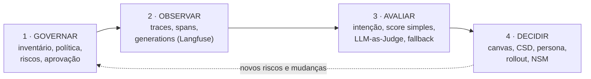

# Calmaria Spas — Governança, observabilidade e avaliação de um assistente de IA

> Checkpoint **Nível 3** da carreira **Especialista em IA** (Alura). Um assistente virtual baseado em LLM recomenda tratamentos de bem-estar, mas dá respostas genéricas e inconsistentes, e ninguém sabe o que ele faz em produção. O projeto organiza a **governança**, **instrumenta** o assistente com Langfuse, **avalia** as respostas automaticamente (score simples, intenção, LLM-as-Judge, thresholds e fallback) e define a **estratégia de produto** e o **rollout**.



**Status (2026-10-25):** todas as etapas implementadas. O código foi testado **sem rede** (46 testes passando, incluindo a hierarquia de spans). A **execução com OpenAI e Langfuse está pendente**, porque o `.env` foi entregue sem credenciais. Nenhum resultado de modelo foi inventado. Detalhes em [ENTREGA.md](ENTREGA.md).

## ❓ Perguntas que o projeto responde

| Etapa | Pergunta-chave | Pasta |
|---|---|---|
| 1 | Quais IAs a empresa usa, quanto risco cada uma traz, quem responde por elas e o que é preciso para aprovar uma nova? | [etapa-1-governanca/](etapa-1-governanca/) |
| 2 | Quando o assistente responde mal, como descobrimos qual pergunta, prompt, modelo, tempo e custo levaram àquilo? | [etapa-2-observabilidade/](etapa-2-observabilidade/) |
| 3 | Como medir a qualidade das respostas sem ler uma a uma, e o que fazer quando ela é baixa? | [etapa-3-avaliacao/](etapa-3-avaliacao/) |
| 4 | Que produto construir, para quem, e como colocá-lo no ar sem riscos para clientes e marca? | [etapa-4-produto/](etapa-4-produto/) |

## 🗂️ Estrutura

```text
├── dados/calmaria_interacoes.csv      dataset do curso (50 interações, validado)
├── prompts/                           assistente_calmaria · baseline · improved · classificar_intencao · juiz_calmaria
├── src/
│   ├── config.py                      caminhos, modelo, PROMPT_FILES, thresholds (tudo centralizado)
│   ├── dataset.py                     carga + validação do CSV + preprocessing
│   ├── prompts.py                     leitura dos prompts .md
│   ├── observabilidade.py             Langfuse v5 + máscara de PII
│   ├── llm.py                         chamada ao modelo via langfuse.openai
│   ├── scoring.py                     simple_score, parsing do juiz, severidade, resumo (funções puras)
│   ├── verificar_conexao.py           checa .env, dataset, prompts e auth_check()
│   ├── pipeline_assistente.py         Etapa 2
│   ├── avaliar_intencoes.py           Etapa 3.1
│   └── avaliar_respostas.py           Etapas 3.2 a 3.4
├── tests/                             pytest: scoring, dataset, fluxo offline, hierarquia de spans
├── etapa-1-governanca/                inventário, política, matriz de riscos, fluxo de aprovação
├── etapa-2-observabilidade/           guia de execução e verificação no Langfuse + evidências
├── etapa-3-avaliacao/                 regras de decisão + relatório de avaliação
├── etapa-4-produto/                   canvas, CSD, persona, rollout, síntese executiva
├── DECISOES.md · ENTREGA.md · RELATORIO_DO_PROJETO.md
└── estudos/                           material de estudo pessoal (fora do Git)
```

## ⚙️ Instalação

Requer **Python 3.10+** (testado em 3.14.0, Windows).

```powershell
python -m venv .venv
.venv\Scripts\activate          # Linux/macOS: source .venv/bin/activate
pip install -r requirements.txt
```

## 🔑 Configuração
O arquivo `.env` já existe (vazio) e está no `.gitignore`. O modelo comentado está em [.env.example](.env.example).

| Variável | Onde obter |
|---|---|
| `OPENAI_API_KEY` | platform.openai.com → API keys |
| `OPENAI_MODEL` | Padrão `gpt-4o-mini` |
| `LANGFUSE_PUBLIC_KEY` · `LANGFUSE_SECRET_KEY` | Langfuse Cloud → projeto → Settings → API Keys |
| `LANGFUSE_BASE_URL` | `https://cloud.langfuse.com` (EU) ou `https://us.cloud.langfuse.com` (US) |

Nunca coloque chaves no código, em prints, em capturas de tela ou em commits.

## ▶️ Execução

```powershell
python -m pytest                                  # testes (sem rede, sem custo)
python src\verificar_conexao.py                   # ambiente + auth_check() do Langfuse
python src\pipeline_assistente.py --comparar      # Etapa 2: baseline x improved (2 chamadas)
python src\avaliar_intencoes.py                   # Etapa 3.1: 10 chamadas
python src\avaliar_respostas.py                   # Etapas 3.2–3.4: 20 chamadas + 2 por caso crítico
.venv\Scripts\python etapa-1-governanca\gerar_planilhas.py   # regenera planilhas
.venv\Scripts\python etapa-4-produto\gerar_planilhas.py
```

## ✅ Validação
1. `python -m pytest` → **46 passed** (resultado real em 2026-10-25).
2. Com credenciais: siga o guia de verificação no Langfuse em [etapa-2-observabilidade/README.md](etapa-2-observabilidade/README.md#como-verificar-na-interface-do-langfuse).
3. Preencha o [relatório de avaliação](etapa-3-avaliacao/relatorio_avaliacao.md) e a [síntese executiva](etapa-4-produto/sintese_executiva.md) com os números reais.
4. Salve as capturas em [etapa-2-observabilidade/evidencias/](etapa-2-observabilidade/evidencias/).

## O que está integrado em código × o que é processo

| Conexão | Situação |
|---|---|
| Dataset → pipeline → traces, spans e generations no Langfuse | **Código** (testado offline; execução real pendente) |
| Geração → simple_score → LLM-as-Judge → severidade → fallback → evento | **Código**, no mesmo script |
| Thresholds de severidade | **Código** (`config.py`) |
| Classificação de risco das soluções | **Código** (gerador de planilhas) |
| Governança → requisitos do código (máscara, prompts seguros, fallback) | **Conceitual**: as decisões da Etapa 1 viraram regras nos prompts e no código, mas não há verificação automática de conformidade |
| Scores → monitoramento contínuo, alertas | **Processo manual**: a avaliação roda sob demanda; não há agendamento nem alerta |
| Monitoramento → decisões de produto e rollout | **Processo documentado** (Etapa 4); depende de feature flag, A/B e feedback que não existem |
| Revisão humana dos casos com nota 3 | **Processo**: o script identifica os casos, mas não há fila de revisão |

## 🧠 Decisões principais
Ver [DECISOES.md](DECISOES.md). Em resumo: Langfuse **v5** (API verificada; difere da v3 das aulas), execução real pendente, falhas de avaliação contadas à parte das notas baixas, grupos de severidade mutuamente exclusivos e classificação de risco calculada.

## ⚠️ Aviso
O assistente atua em **bem-estar**, não em saúde. Ele **não está pronto para uso clínico** nem para dar aconselhamento médico. Casos de saúde, reações adversas e situações urgentes devem ser encaminhados a profissionais.
