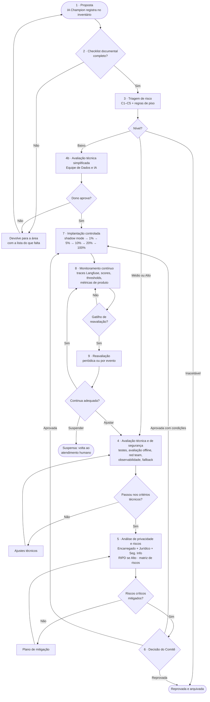

# Fluxo de aprovação de soluções de IA — Calmaria Spas

O diagrama está em Mermaid, que o GitHub renderiza automaticamente. Para editar visualmente, cole o bloco em [mermaid.live](https://mermaid.live) ou no draw.io (**Arranjar → Inserir → Avançado → Mermaid**). Para levar ao Miro, exporte como PNG ou SVG no mermaid.live.

## Etapas, responsáveis e critérios de bloqueio

| # | Etapa | Responsável | Entradas exigidas | **Bloqueia se…** |
|---|---|---|---|---|
| 1 | Proposta | IA Champion da área | Problema de negócio, área demandante, dono proposto | Não há problema de negócio claro nem dono nomeado. |
| 2 | Checklist documental | IA Champion + Equipe de Dados e IA | Ficha da solução: finalidade, dados usados (com origem), público impactado, fornecedor e modelo, métrica de sucesso, plano de fallback, papel do humano | **Qualquer item vazio.** "A definir" não é aceito para finalidade, dados e dono. |
| 3 | Triagem de risco | Equipe de Dados e IA + Encarregado(a) | Pontuação C1–C5 justificada | Pontuação sem justificativa. Prática proibida → reprovação imediata. |
| 4 | Avaliação técnica e de segurança | Equipe de Dados e IA + Segurança da Informação | Resultados de avaliação offline (ex.: score médio do LLM-as-Judge, acurácia de intenção), testes de red team, instrumentação ativa, fallback testado | Sem avaliação com dados representativos; **sem observabilidade** (não há como auditar depois); sem fallback; credenciais no código; score médio abaixo da meta definida na proposta. |
| 5 | Privacidade e riscos | Encarregado(a), Jurídico, Seg. Info | Base legal, RIPD (risco Alto), matriz de riscos, contratos dos fornecedores, retenção dos logs | Dado sensível sem base legal; RIPD ausente para risco Alto; **risco Crítico sem mitigação implementada**; fornecedor sem cláusulas de proteção de dados. |
| 6 | Decisão | Comitê de Governança (Médio e Alto) · Dono (Baixo) | Parecer das etapas 4 e 5 | Qualquer parecer anterior negativo. "Aprovada com condições" exige prazo e dono para cada condição. |
| 7 | Implantação controlada | Dono da solução + Equipe de Dados e IA | Plano de rollout com critérios de avanço e interrupção (Etapa 4 do projeto) | Avançar de fase sem atingir o critério de estabilização. |
| 8 | Monitoramento | Dono da solução | Indicadores definidos na matriz de riscos e no plano de rollout | — |
| 9 | Reavaliação | Comitê (Médio e Alto) · Dono (Baixo) | Indicadores do período, incidentes, mudanças | Indicador fora do limite sem plano de ação → suspensão. |

## Gatilhos de reavaliação
**Periódicos** (conforme o nível): Alto, trimestral · Médio, semestral · Baixo, anual.

**Por evento** (qualquer nível):
- troca de modelo ou de fornecedor (ex.: `OPENAI_MODEL` alterado);
- nova versão do prompt principal ou do prompt do juiz;
- novo tipo de dado ou nova finalidade;
- incidente de IA (ver [política §9](politica_uso_responsavel.md#9-monitoramento-e-incidentes));
- degradação: score médio do juiz abaixo da meta, aumento de casos críticos (score ≤ 2) ou de falhas técnicas, conforme os limites do [plano de rollout](../etapa-4-produto/rollout_monitoramento.md).

## Situação atual do assistente (IA-01) no fluxo
O assistente **já está em produção (piloto) sem ter passado por este fluxo**, que é a situação descrita no enunciado. A recomendação é tratá-lo como uma reavaliação (etapa 9 → etapa 4):

| Etapa | Situação | Evidência |
|---|---|---|
| 2. Checklist documental | 🟡 Parcial | Ficha no [inventário](inventario_solucoes_ia.csv); falta definir a métrica de sucesso oficial |
| 3. Triagem | ✅ Alto | [inventário](inventario_solucoes_ia.csv) |
| 4. Avaliação técnica | 🟡 Código pronto, execução pendente | [Etapa 2](../etapa-2-observabilidade/README.md) e [Etapa 3](../etapa-3-avaliacao/README.md) |
| 5. Privacidade e riscos | 🟡 Matriz feita; RIPD e contratos pendentes | [matriz_riscos.md](matriz_riscos.md) |
| 6. Decisão | ⏳ Pendente | — |
| 7. Implantação controlada | ⏳ Planejada | [rollout_monitoramento.md](../etapa-4-produto/rollout_monitoramento.md) |

Como há 4 riscos Críticos (R01, R03, R05, R06), o critério da etapa 5 **impede a expansão** do assistente até que as mitigações estejam implementadas.
