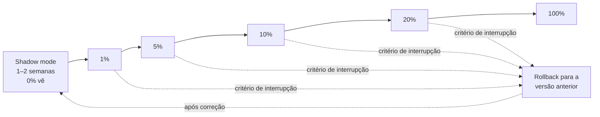
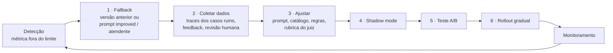

# Plano de rollout e monitoramento — Assistente com recomendação híbrida

> Todas as **metas e limites** abaixo são **propostas** para aprovação do Comitê de Governança. Não são resultados medidos. Devem ser recalibrados com a linha de base obtida no shadow mode e na primeira execução da avaliação (Etapa 3).

## 1. Visão geral

**Pré-condição para sair do shadow mode:** os riscos **Críticos** da [matriz de riscos](../etapa-1-governanca/matriz_riscos.md) (R01, R03, R05, R06) com mitigação implementada e verificada, como exige o [fluxo de aprovação](../etapa-1-governanca/fluxo_aprovacao.md).

## 2. Fases

| Fase | Quem vê a nova versão | Duração mínima | Para avançar (estabilização) | Responsável pela decisão |
|---|---|---|---|---|
| **Shadow mode** | Ninguém: a nova versão roda em paralelo sobre o tráfego real e as respostas só vão para o Langfuse (tag `shadow`) | 1–2 semanas | Score médio do juiz ≥ versão atual; críticos ≤ 10%; zero casos de saúde sem encaminhamento; erro técnico < 2%; p95 de latência ≤ 5 s | Product Owner + Engenharia de IA |
| **1%** | Colaboradores e clientes que aceitaram testar (opt-in) | 1 semana | Mesmos critérios + nenhum incidente; feedback 👎 ≤ 30% | Product Owner |
| **5%** | Amostra aleatória de clientes **recorrentes** | 1 semana | Conversão da sessão com IA não inferior ao controle | Product Owner |
| **10%** | Amostra aleatória incluindo **novos** (cold start) | 1–2 semanas | Critérios anteriores mantidos para o grupo "novo" separadamente | Product Owner + PM de IA |
| **20%** | Todos os perfis, incluindo **VIP** | 2 semanas | Teste A/B com amostra suficiente para comparar conversão (calcular antes) | Comitê de Governança |
| **100%** | Todos | — | Conversão superior ao controle **ou** não inferior com ganho de satisfação | Comitê de Governança |

> **Shadow mode × teste A/B:** no shadow, o cliente **não vê** a nova versão. Só medimos qualidade técnica (juiz, latência, erros) sem risco para ele. No A/B, **grupos diferentes veem versões diferentes** e medimos efeito no comportamento (conversão, feedback). O shadow responde "a versão é segura e funciona?"; o A/B responde "a versão gera mais valor?".

## 3. Critérios de interrupção (rollback imediato)
Qualquer um destes, em qualquer fase:
- **Incidente de saúde**: resposta que recomenda tratamento a quem relatou alergia, lesão, gestação de risco ou sintoma, sem encaminhamento.
- **Exposição de dado pessoal** (ex.: dado de outro cliente na resposta).
- **Erro técnico > 5%** das chamadas por 1 hora, ou p95 de latência > 10 s por 1 hora.
- **Score médio do juiz < 3,5** em dois dias seguidos (amostra diária).
- **Casos críticos (nota ≤ 2) > 20%** da amostra diária.
- **Conversão** do grupo com a nova versão significativamente **menor** que a do controle.

Quem pode interromper: o **Product Owner** ou o plantão da **Engenharia de IA**, sem aprovação prévia (política §9). O Comitê é informado em até 24 h.

## 4. Métricas por frequência

| Frequência | Métrica | Definição | Fonte | Responsável |
|---|---|---|---|---|
| **Diária** | Taxa de clique | Recomendações clicadas ÷ recomendações exibidas | Analytics do site/app | Produto |
| | Zero results | % de pedidos de recomendação sem nenhuma sugestão (ou só "fale com atendente") | Traces (output vazio ou encaminhamento) | Engenharia de IA |
| | Latência | p50 e p95 por resposta | Langfuse (latência do trace e da generation) | Engenharia de IA |
| | Erros | % de chamadas com erro técnico; % de falhas de parsing do juiz | Langfuse (level ERROR) | Engenharia de IA |
| **Semanal** | Conversão com IA × sem IA | Sessões com agendamento ÷ sessões, por grupo do A/B | Agendamento + atribuição de grupo | PM de IA |
| | Feedback explícito | % 👍 e 👎 e motivos | Botões no chat (score do Langfuse) | Produto |
| | Categorias populares | Distribuição de intenções e categorias pedidas | Classificador de intenção + traces | Produto |
| | Qualidade | Score médio do juiz, % críticos, nº de fallbacks | `avaliar_respostas.py` sobre amostra semanal | Engenharia de IA |
| **Mensal** | Drift de dados | Mudança na distribuição de intenções, categorias, tamanho das perguntas e termos novos em relação à linha de base | Traces | Ciência de Dados |
| | Custo por inferência | Custo total ÷ nº de interações (inclui juiz e fallback) | Langfuse (custo) | Engenharia de IA + Financeiro |
| | Necessidade de retreino ou ajuste | Decisão com base em drift + queda de qualidade (no LLM, "retreino" costuma ser ajuste de prompt, catálogo ou regras) | Relatório mensal | Comitê |
| **Trimestral** | North Star Metric | Ver seção 6 | Agendamento + atribuição | Diretoria |
| | Receita incremental | Receita dos agendamentos atribuídos à IA − receita esperada sem IA (estimada pelo grupo de controle) | Financeiro + A/B | Diretoria Financeira |

> **Drift × degradação:** *drift* é a **mudança nos dados de entrada** (ex.: no inverno aumentam os pedidos de tratamentos corporais; aparece um tratamento novo que o prompt não conhece). *Degradação* é a **queda no resultado** (score, conversão). O drift pode **causar** a degradação, mas também pode acontecer sem ela, e a degradação pode ter outra causa (ex.: o fornecedor atualizou o modelo).

## 5. Ciclo de ação em caso de degradação

| Passo | O que acontece | Quem |
|---|---|---|
| 1. Fallback | **Técnico:** API fora → mensagem padrão + atendente. **Por qualidade:** volta à versão anterior; casos críticos usam o prompt improved | Engenharia de IA |
| 2. Coletar dados | Filtrar no Langfuse os traces com nota ≤ 2 e 👎; revisão humana de uma amostra | Engenharia de IA + Atendimento |
| 3. Ajustar | Corrigir a causa: nova versão do prompt (versionada no Git), catálogo, regras de segurança | Engenharia de IA |
| 4. Shadow | Nova versão em paralelo, comparada com a atual pelo juiz | Engenharia de IA |
| 5. A/B | Grupos com e sem a mudança | PM de IA |
| 6. Rollout | Fases da seção 2 | Product Owner |

## 6. North Star Metric

**Agendamentos concluídos por semana originados de recomendações do assistente** (o cliente recebeu a recomendação, agendou e a sessão foi realizada).

| Por que esta métrica | Conexão |
|---|---|
| **Receita:** sessão realizada é receita; recomendação clicada ou agendamento cancelado não são | Receita incremental = NSM × ticket médio, comparado ao controle |
| **Retenção:** quem tem uma boa primeira experiência volta | KPI de apoio: % de clientes novos que voltam em até 90 dias |
| **Satisfação:** a recomendação só "conta" se a sessão aconteceu; somada à avaliação pós-sessão, evita otimizar só o clique | KPI de apoio: nota pós-sessão dos tratamentos recomendados |

**Métricas de modelo × métricas de produto:** o score do juiz, a acurácia de intenção e a latência dizem **se a IA funciona**. Conversão, NSM e receita dizem **se a IA gera valor**. Um score alto com conversão baixa indica respostas "bonitas" que não ajudam a decidir. Uma conversão alta com score baixo pode indicar promessas indevidas (risco R08). As duas visões precisam ser acompanhadas juntas.

## 7. Como traces, scores e thresholds sustentam auditoria e governança

| Pergunta de auditoria | Evidência no projeto |
|---|---|
| "Que resposta o cliente X recebeu e por quê?" | Trace no Langfuse: input, versão do prompt (`version`, `prompt_version`), modelo, output, `session_id` e `user_id` pseudonimizado |
| "Quanto custa e quão rápido é?" | Tokens, custo e latência por generation |
| "A qualidade caiu depois da mudança Y?" | Score do juiz por versão do prompt, ao longo do tempo |
| "Quais casos foram tratados automaticamente?" | Eventos `fallback-applied` com score antes e depois |
| "Quais regras decidem a ação?" | `SCORE_THRESHOLD_REVIEW` e `SCORE_THRESHOLD_FALLBACK` versionados em `src/config.py` |
| "O sistema foi aprovado para isso?" | Inventário, matriz de riscos e registro da decisão do Comitê (Etapa 1) |

**O que ainda é manual:** a avaliação roda por script sob demanda (não há agendamento automático); o feedback 👍/👎, o A/B e a atribuição de agendamentos dependem de sistemas que ainda não existem; o rollout por porcentagem exige uma *feature flag* no produto. Ver a seção "O que está integrado em código × o que é processo" do [README](../README.md#o-que-está-integrado-em-código--o-que-é-processo).
